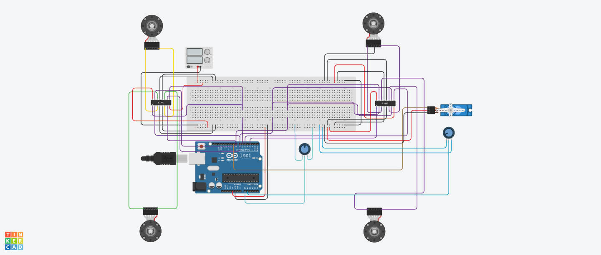

# 4WD Electric Vehicle Control System (Tinkercad)

A four-wheel-drive (4WD) electric vehicle control system simulated using an Arduino Uno, two L293D motor driver ICs, four DC motors with encoders, two potentiometers, and a micro servo.

The Arduino controls the speed of all four motors using pulse-width modulation (PWM). One potentiometer acts as an accelerator, while another controls a servo representing the vehicle's steering mechanism. The project demonstrates the basic electronic control principles of an electric vehicle, including drive-by-wire acceleration, motor control, and electronic steering. It is an educational simulation, not a roadworthy vehicle design.

🔗 **Tinkercad simulation:** [open the circuit](https://www.tinkercad.com/things/dRuR4My0qkG-4wd-electric-vehicle)

---

## How it works

The system uses an Arduino Uno as the main vehicle controller.

Four DC motors represent the vehicle's wheels. Two L293D dual H-bridge motor drivers control these motors. An H-bridge is an electronic circuit that controls the direction of current through a motor, allowing it to rotate in either direction.

The Arduino receives two analog inputs:

1. Accelerator potentiometer connected to A0.
2. Steering potentiometer connected to A1.

The accelerator controls motor speed through PWM.

PWM rapidly switches a motor driver's output between powered and unpowered states. Changing the percentage of time the signal remains HIGH changes the motor's effective power.

The steering potentiometer controls a micro servo connected to D9.

The servo represents the steering actuator. In a physical vehicle, the actuator would require a mechanical linkage to turn the front wheels.

### Motor control architecture

The system uses three PWM channels:

| Motor | Arduino PWM pin | Driver |
|---|---|---|
| Front left | D3 | L293D #2 |
| Front right | D5 | L293D #2 |
| Rear left | D6 | L293D #1 |
| Rear right | D6 | L293D #1 |

Both rear motors receive the same PWM command.

The front motors have separate PWM connections, allowing independent speed commands in future versions.

All four motors currently receive the same PWM value during normal acceleration.

Motor direction is controlled through two shared Arduino pins:

| Pin | Function |
|---|---|
| D7 | Direction input 1 |
| D8 | Direction input 2 |

The firmware configures D7 HIGH and D8 LOW for the tested forward-running configuration.

Motor polarity may need to be reversed depending on the physical orientation of each motor.

### Accelerator operation

The Arduino reads the accelerator potentiometer using its analog-to-digital converter (ADC).

The ADC converts the input voltage into a numerical value between 0 and 1023.

This value is mapped to a PWM command between 0 and 255.

| Accelerator position | ADC reading (nominal) | PWM command | Duty cycle |
|---|---:|---:|---:|
| Minimum | 0 | 0 | 0% |
| Approximately 25% | 256 | 64 | 25.1% |
| Approximately 50% | 512 | 128 | 50.2% |
| Approximately 75% | 767 | 191 | 74.9% |
| Maximum | 1023 | 255 | 100% |

These values describe the intended mapping. They are not separately measured test results.

The PWM duty cycle is calculated using:

$$
D = \frac{PWM}{255} \times 100
$$

where:

- $D$ is the PWM duty cycle in percent.
- $PWM$ is the command value between 0 and 255.

For example, at PWM = 150:

$$
D = \frac{150}{255} \times 100
$$

$$
D \approx 58.82\%
$$

The motor driver receives an external supply of 8.20 V.

For an ideal PWM switch, the average applied voltage at PWM = 150 would be:

$$
V_{avg} = 8.20 \times \frac{150}{255}
$$

$$
V_{avg} \approx 4.82\text{ V}
$$

This is an idealized calculation. The L293D has internal voltage drops, so the actual motor terminal voltage differs.

### Steering operation

The steering potentiometer controls a micro servo.

The Arduino maps its analog reading to an angle between 60° and 120°.

| Steering input | Servo angle | Intended direction |
|---|---:|---|
| Minimum | 60° | Left |
| Centre | 90° | Straight |
| Maximum | 120° | Right |

The servo's neutral position is 90°.

The potentiometer's visual centre was observed to be slightly different from the position producing exactly 90°.

This small offset was accepted for the simulation.

### Measurement method

| Quantity | Method |
|---|---|
| Accelerator position | Arduino ADC reading from A0 |
| Steering position | Arduino ADC reading from A1 |
| Motor PWM | Arduino PWM command |
| Steering angle | Servo command calculated by Arduino |
| Motor RPM | Observed using Tinkercad's motor simulation display |
| Motor supply voltage | External adjustable DC power supply setting |

The Arduino does not currently measure motor RPM.

Although the motors include encoders, their output signals are not connected to the Arduino in this version.

Therefore, the propulsion system operates using open-loop control.

Open-loop control means the controller sends commands without measuring the actual result.

---

## Design files

| File | Description |
|---|---|
| [Schematic (PDF)](4WD-Electric-Vehicle-Control-System.pdf) | Circuit schematic exported from Tinkercad |
| [PCB board file (.brd)](4WD-Electric-Vehicle-Control-System.brd) | Board design file exported from Tinkercad |
| [`EV_Controller.ino`](EV_Controller.ino) | Arduino firmware for propulsion and steering |
| [Circuit image](4WD-Electric-Vehicle-Control-System.png) | Screenshot or image exported from Tinkercad |

The exported design files should be placed in the repository using the filenames shown above.

---

## Parts

| Part (Tinkercad name) | Qty | Settings |
|---|---:|---|
| Arduino Uno R3 | 1 | 5 V logic |
| L293D motor driver IC | 2 | Dual H-bridge motor driver |
| DC Motor with Encoder | 4 | Motor speed controlled using PWM |
| Micro Servo | 1 | Steering range: 60° to 120° |
| Potentiometer | 2 | Accelerator and steering inputs |
| Breadboard | 1 | Power and signal distribution |
| Adjustable DC Power Supply | 1 | 8.20 V motor supply |
| Jumper wires | As required | Circuit connections |

### Real-hardware considerations

A physical vehicle would require substantially different components.

The L293D is intended for small motors and has limited current-handling capability. It is not suitable for driving full-size electric vehicle traction motors.

A real electric vehicle would require appropriately rated traction motors, high-power inverters, battery management, thermal protection, braking systems, and automotive-grade controllers.

The Arduino Uno and L293D combination is suitable for demonstrating basic motor-control principles in simulation.

---

## Wiring

### Arduino pin assignments

| Arduino pin | Purpose | Connection |
|---|---|---|
| D3 | Front-left PWM | L293D #2, pin 1 |
| D5 | Front-right PWM | L293D #2, pin 9 |
| D6 | Rear-wheel PWM | L293D #1, pins 1 and 9 |
| D7 | Motor direction 1 | Both L293D ICs, pins 2 and 10 |
| D8 | Motor direction 2 | Both L293D ICs, pins 7 and 15 |
| D9 | Steering servo signal | Micro servo signal terminal |
| A0 | Accelerator input | Accelerator potentiometer wiper |
| A1 | Steering input | Steering potentiometer wiper |
| 5V | Logic power | Motor driver logic supplies, potentiometers and servo |
| GND | Common ground | Motor drivers, power supply and control components |

### L293D #1: Rear-wheel driver

| L293D pin | Purpose | Connection |
|---|---|---|
| 1 | Enable 1,2 | Arduino D6 |
| 2 | Input 1 | Arduino D7 |
| 3 | Output 1 | Rear-left motor terminal 1 |
| 4 | Ground | Common GND |
| 5 | Ground | Common GND |
| 6 | Output 2 | Rear-left motor terminal 2 |
| 7 | Input 2 | Arduino D8 |
| 8 | Motor supply | External 8.20 V |
| 9 | Enable 3,4 | Arduino D6 |
| 10 | Input 3 | Arduino D7 |
| 11 | Output 3 | Rear-right motor terminal 1 |
| 12 | Ground | Common GND |
| 13 | Ground | Common GND |
| 14 | Output 4 | Rear-right motor terminal 2 |
| 15 | Input 4 | Arduino D8 |
| 16 | Logic supply | Arduino 5V |

### L293D #2: Front-wheel driver

| L293D pin | Purpose | Connection |
|---|---|---|
| 1 | Enable 1,2 | Arduino D3 |
| 2 | Input 1 | Arduino D7 |
| 3 | Output 1 | Front-left motor terminal 1 |
| 4 | Ground | Common GND |
| 5 | Ground | Common GND |
| 6 | Output 2 | Front-left motor terminal 2 |
| 7 | Input 2 | Arduino D8 |
| 8 | Motor supply | External 8.20 V |
| 9 | Enable 3,4 | Arduino D5 |
| 10 | Input 3 | Arduino D7 |
| 11 | Output 3 | Front-right motor terminal 1 |
| 12 | Ground | Common GND |
| 13 | Ground | Common GND |
| 14 | Output 4 | Front-right motor terminal 2 |
| 15 | Input 4 | Arduino D8 |
| 16 | Logic supply | Arduino 5V |

### Accelerator potentiometer

| Potentiometer terminal | Connection |
|---|---|
| Outer terminal 1 | Arduino 5V |
| Middle terminal | Arduino A0 |
| Outer terminal 2 | Common GND |

### Steering potentiometer

| Potentiometer terminal | Connection |
|---|---|
| Outer terminal 1 | Arduino 5V |
| Middle terminal | Arduino A1 |
| Outer terminal 2 | Common GND |

### Steering servo

| Servo terminal | Connection |
|---|---|
| Signal | Arduino D9 |
| Power | Regulated 5V |
| Ground | Common GND |

### Power distribution

| Supply | Connection |
|---|---|
| External supply positive | Both L293D motor supply pins (pin 8) |
| External supply negative | Common GND |
| Arduino 5V | Both L293D logic supply pins (pin 16) |
| Arduino GND | Common GND |

⚠️ **Do not connect the external 8.20 V positive supply directly to the Arduino 5V pin.**

⚠️ **Do not connect the motor supply positive rail to the logic supply positive rail.**

⚠️ All components must share a common ground reference.

⚠️ Do not power the motors directly from the Arduino 5V pin.

⚠️ The servo is powered from the Arduino 5V supply in this simulation. A physical implementation may require a separate regulated servo supply.

⚠️ The L293D has a limited output-current rating. Actual motor current must be checked before attempting a physical implementation.

---

## Test procedure

1. Open the Tinkercad circuit.

   Verify that the Arduino, motor drivers, motors, potentiometers and servo are connected.

2. Set the external motor power supply to 8.20 V.

   Confirm that the Arduino logic supply remains at 5 V.

3. Start the simulation.

   The Arduino should initialize the motor drivers and steering servo.

4. Set the accelerator potentiometer to its minimum position.

   The motors should remain stopped.

5. Gradually increase the accelerator.

   All four motors should increase their rotational speeds.

6. Set the accelerator to maximum.

   Observe the motor RPM values displayed by Tinkercad.

   A peak speed of approximately 241 RPM was observed during testing at the configured 8.20 V supply.

7. Rotate the steering potentiometer.

   The servo should move between approximately 60° and 120°.

8. Return the steering potentiometer near its centre.

   The servo should return to approximately 90°.

9. Open the Arduino Serial Monitor.

   Observe the accelerator ADC reading, PWM command, duty cycle and commanded steering angle.

10. Reduce the accelerator to minimum.

    The motors should stop while steering remains independently controllable.

---

## Results and observations

- All four DC motors operated successfully.
- Two L293D motor drivers were sufficient to control four motors.
- The front-left and front-right motors received separate PWM signals.
- Both rear motors were successfully controlled using a shared PWM signal.
- The rear motors rotated at approximately equal speeds during testing.
- The accelerator potentiometer successfully controlled all four motors.
- The steering potentiometer successfully controlled the micro servo.
- The servo operated over the configured range of 60° to 120°.
- The straight-ahead position corresponded to approximately 90°.
- The potentiometer's visual centre was slightly offset from the exact 90° steering position.
- The motor supply was configured to 8.20 V.
- The Arduino logic operated at 5 V.
- The maximum observed motor speed was approximately 241 RPM at the configured supply voltage.
- Earlier testing showed motor speeds of approximately 140 RPM under a lower PWM command.
- Motor RPM values were observed using Tinkercad's motor simulation interface.

### PWM calculation

At PWM = 150:

$$
D = \frac{150}{255} \times 100
$$

$$
D \approx 58.82\%
$$

This means the PWM signal is HIGH for approximately 58.82% of each cycle.

At PWM = 255:

$$
D = \frac{255}{255} \times 100 = 100\%
$$

This represents the maximum PWM command.

The measured peak motor speed of approximately 241 RPM is a simulation observation, not a value calculated from PWM.

### Motor-speed observation

The observed peak rotational speed was:

$$
N \approx 241\text{ RPM}
$$

The corresponding rotational frequency is:

$$
f = \frac{N}{60}
$$

$$
f = \frac{241}{60} \approx 4.02\text{ revolutions/second}
$$

This calculation converts the observed motor speed into revolutions per second.

It does not establish the vehicle's road speed, which would depend on wheel diameter, gearing and other factors.

---

## Known issues and limitations

- The project is a Tinkercad simulation, not a physical electric vehicle.
- The Arduino does not receive feedback from the motor encoders.
- Motor RPM is visible in Tinkercad but is not measured by the Arduino.
- Motor speed is controlled using open-loop PWM.
- The rear motors share one PWM signal and cannot be adjusted independently.
- The front motors have independent PWM connections but currently receive identical speed commands.
- The system does not implement an electronic differential.
- The steering servo is not mechanically connected to the front wheels.
- Tinkercad does not simulate realistic vehicle movement, traction or road conditions.
- The steering potentiometer's visual centre does not correspond exactly to the neutral servo position.
- The circular potentiometers are less convenient to operate than physical accelerator and steering controls.
- The current firmware supports forward propulsion only.
- No independent braking system has been implemented.
- No automatic motor fault detection or emergency-stop system has been implemented.
- The L293D motor drivers are unsuitable for full-size EV traction applications.

### Unsuccessful instrumentation experiment

An experimental second Arduino was introduced to create an independent vehicle instrumentation system.

The proposed design used four I2C LCDs to display individual wheel RPM values.

During initial testing:

- The first LCD was configured with I2C address `0x20`.
- The LCD did not initialize successfully.
- An I2C scanner reported that no I2C devices were detected.
- Directly connecting the LCD to the second Arduino did not resolve the issue.
- An alternative LCD initialization approach was also unsuccessful.

The exact cause was not established. A Tinkercad simulation or component compatibility issue was suspected.

The unfinished instrumentation circuit was excluded from the initial release.

The propulsion and steering systems continued working independently.

---

## Things I learned

- How an Arduino can control multiple DC motors using external motor driver ICs.
- How an L293D dual H-bridge controls two motors.
- Why motor power and microcontroller logic power must be handled separately.
- Why all connected electronic subsystems need a common ground reference.
- How PWM controls motor power.
- How multiple motors can share one PWM signal.
- Why identical PWM commands do not guarantee identical motor RPM.
- How potentiometers provide analog control inputs.
- How an Arduino ADC converts analog voltages into digital readings.
- How a micro servo can represent an electronically controlled steering actuator.
- How drive-by-wire systems translate driver inputs into electronic commands.
- Why motor encoders are needed for closed-loop speed regulation.
- The difference between commanded motor speed and measured motor speed.
- Why real vehicles use more sophisticated motor controllers, sensors and power electronics.
- Why vehicle safety requires independent braking, fault detection and validated control software.
- How separating propulsion and instrumentation into independent controllers can simplify software responsibilities.
- How simulation limitations can affect the development of electronic systems.

---

## Future improvements

- Connect all four motor encoders to a dedicated instrumentation Arduino.
- Calculate individual wheel RPM from encoder pulses.
- Implement a working RPM dashboard.
- Revisit the I2C LCD compatibility problem.
- Add steering potentiometer calibration.
- Implement an electronic differential for improved wheel-speed control during turns.
- Add an independent braking input.
- Implement accelerator signal validation.
- Add an emergency-stop mechanism.
- Introduce motor fault detection.
- Investigate closed-loop motor speed control using encoder feedback.
- Implement a proportional-integral-derivative (PID) speed controller.
- Add simulated battery voltage monitoring.
- Explore regenerative braking concepts.
- Investigate automotive communication protocols such as CAN.
- Explore functional safety principles used in real electric vehicles.

---

## License

This project is licensed under the MIT License.

See the [LICENSE](LICENSE) file for details.
